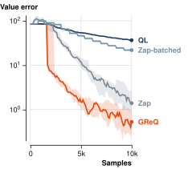

# Greedy-resolvent matrix-gain Q-learning

[](https://www.python.org/)
[](https://docs.jax.dev/)

Official implementation of GReQ that fully reproduce the results and the figures.

## Installation

We recommend installation via [uv](https://docs.astral.sh/uv/getting-started/installation/):

```bash
uv sync --locked
```

## Experiments

```bash
uv run -m scripts.run       # Run one algorithm
uv run -m scripts.finetune  # Tune hyperparameters
uv run -m scripts.report    # Evaluate selected settings
```

Finetuning creates `runs/results/` with results in `tuning.csv`. The report saves the selected settings' evaluation results in `evaluation.csv`.

**Render**: To render the results run the `figures` script:

```bash
uv run -m scripts.figures   # Generate figures
```

The script will produce `runs/results/figures.html`, which you can open in a browser.
This file contains interactive figures and a control panel for exploring the results.



Above is an example of Garnet MDP with $\gamma = 0.99$.
Curves show median value error over eleven trajectory seeds and shaded bands span the 25th–75th percentiles.

## Citation


```bibtex
@misc{sunil_greq,
  title  = {Greedy-resolvent matrix-gain {Q}-learning},
  author = {Sunil, Mukund and Ok, Tolga and Sharifi Kolarijani, Mohamad Amin},
  year   = {2026},
  url    = {PAPER_URL}
}
```
